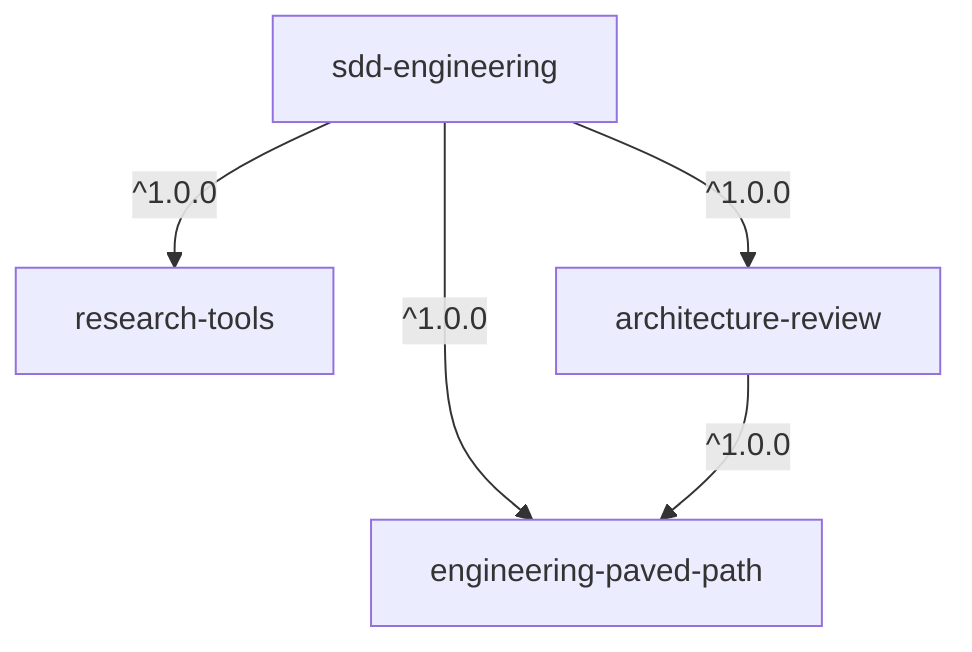

# dev-digest-agentic-sdd-kit

A Claude Code plugin marketplace with tooling for agentic spec-driven development.

## Usage

Add the marketplace and install a plugin:

```
/plugin marketplace add sinyagin/dev-digest-agentic-sdd-kit
/plugin install sdd-engineering@dev-digest-agentic-sdd-kit
```

`sdd-engineering` pulls in its dependencies (`engineering-paved-path`, `research-tools`, `architecture-review`) automatically. Each of them can also be installed on its own.

To get updates automatically, enable auto-update for this marketplace in `/plugin` → **Marketplaces**.
Otherwise run `/plugin marketplace update dev-digest-agentic-sdd-kit`.

To register the marketplace for everyone working in a project, run this once in that project and commit `.claude/settings.json`:

```
claude plugin marketplace add sinyagin/dev-digest-agentic-sdd-kit --scope project
```

## Plugins

| Plugin | Description |
| --- | --- |
| [`sdd-engineering`](plugins/sdd-engineering) | Spec-Driven Development workflow: spec-creator, implementation-planner, implementer, plan-verifier agents and the `run-plan` / `workflow-retro` skills |
| [`engineering-paved-path`](plugins/engineering-paved-path) | 13 reusable engineering skills: React, Next.js, Fastify, Drizzle, PostgreSQL, Zod, TypeScript, architecture, testing, security, diagrams |
| [`research-tools`](plugins/research-tools) | Read-only `researcher` agent with cited, structured answers |
| [`architecture-review`](plugins/architecture-review) | Read-only `architecture-reviewer` agent that audits diffs against documented contracts |



See [`docs/specs/sdd-engineering-plugins.md`](docs/specs/sdd-engineering-plugins.md) for the design.

## Website

Browse and search every skill, agent, command, hook and MCP server at
**https://sinyagin.github.io/dev-digest-agentic-sdd-kit/**. It rebuilds automatically on every push to `main`
from the contents of `plugins/` (see [`docs/specs/marketplace-site.md`](docs/specs/marketplace-site.md)).

Run it locally:

```
cd site
npm ci
npm run dev        # builds the index, then serves http://localhost:4321/dev-digest-agentic-sdd-kit/
npm test           # indexer + search unit tests
npm run build && npm run test:e2e
```

## Repository layout

```
.claude-plugin/marketplace.json   # marketplace catalog
plugins/<name>/                   # one directory per plugin
  .claude-plugin/plugin.json      # plugin manifest (only file in .claude-plugin/)
  skills/ agents/ commands/ hooks/ evals/
  CHANGELOG.md
scripts/                          # validation, release, and rollback scripts
docs/                             # guidelines, release process, security policy
```

## Contributing

See [CONTRIBUTING.md](CONTRIBUTING.md), [plugin guidelines](docs/PLUGIN-GUIDELINES.md), [releases and rollbacks](docs/RELEASES.md), and [security](docs/SECURITY.md).
