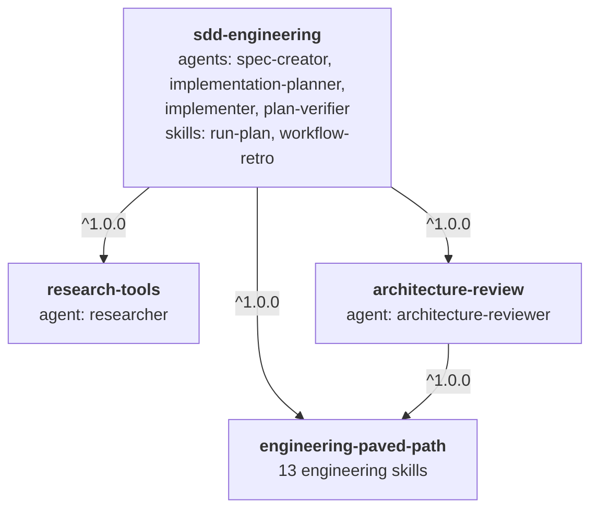
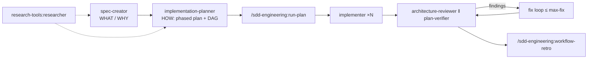

# Spec: sdd-engineering plugin family

| | |
| --- | --- |
| Status | Accepted |
| Date | 2026-10-18 |
| Author | Andrii Syniagin |
| Source | Agents and skills from the DevDigest course project (`.claude/agents`, `.claude/skills`) |

## 1. Purpose

Package a Spec-Driven Development (SDD) workflow as public Claude Code plugins that work in any repository, not only in the project they were built in.

One product plugin, `sdd-engineering`, holds the workflow: four agents and two skills. It depends on three smaller plugins that other plugins can reuse on their own: `engineering-paved-path` (skills), `research-tools` (a researcher agent) and `architecture-review` (an architecture reviewer agent).

### In scope

- `sdd-engineering`: agents `spec-creator`, `implementation-planner`, `implementer`, `plan-verifier`; skills `run-plan` (executes an approved plan) and `workflow-retro` (analyses a finished run).
- `research-tools`: read-only agent `researcher`.
- `architecture-review`: generalized agent `architecture-reviewer`.
- `engineering-paved-path`: React, Next.js, Fastify, Drizzle, PostgreSQL, Zod, TypeScript, architecture, testing, security, diagram and insights skills.
- Evals, a README and a CHANGELOG for every plugin.
- Registering all four plugins in `.claude-plugin/marketplace.json` and removing the placeholder `sdd-kit`.

### Not carried over

- Product specs, plans, reports and retro logs of the source project.
- Secrets, local settings, caches and state (`.state/`, `*-workspace/`, `settings.local.json`).
- Project-specific instructions: module names, package names, repository paths, the source project's name.
- Project-bound components: `pr-self-review`, `dependency-checker`, `brainstorm`, `test-writer`, `doc-writer`, `security-reviewer`, `architecture-reviewer-lite`. They are candidates for later releases.

## 2. Dependency graph



| Plugin | Provides | Depends on |
| --- | --- | --- |
| `engineering-paved-path` | 13 skills (section 4) | — |
| `research-tools` | agent `researcher` | — |
| `architecture-review` | agent `architecture-reviewer` | `engineering-paved-path ^1.0.0` |
| `sdd-engineering` | 4 agents, skills `run-plan`, `workflow-retro` | `engineering-paved-path`, `research-tools`, `architecture-review`, all `^1.0.0` |

All four plugins start at `1.0.0`. Dependencies are declared in `plugin.json` as objects, so the version range is explicit:

```json
"dependencies": [
  { "name": "engineering-paved-path", "version": "^1.0.0" },
  { "name": "research-tools", "version": "^1.0.0" },
  { "name": "architecture-review", "version": "^1.0.0" }
]
```

Bare names resolve against this marketplace. Claude Code resolves ranges through the `<plugin>--v<version>` release tags that `scripts/tag-releases.mjs` already creates.

### Who uses which skill

| Component | `engineering-paved-path` skills |
| --- | --- |
| `spec-creator` | onion-architecture, frontend-architecture, security, mermaid-diagram, zod, engineering-insights |
| `implementation-planner` | all 13 |
| `implementer` | all except mermaid-diagram |
| `plan-verifier` | typescript-expert, onion-architecture, frontend-architecture |
| `architecture-reviewer` | onion-architecture, frontend-architecture, fastify-best-practices, drizzle-orm-patterns, react-best-practices, next-best-practices, typescript-expert, security |
| `researcher` | none |

## 3. Layout

```
plugins/
├── engineering-paved-path/
│   ├── .claude-plugin/plugin.json
│   ├── skills/<skill>/SKILL.md (+ references/, rules/, examples.md, evals/)
│   ├── README.md
│   └── CHANGELOG.md
├── research-tools/
│   ├── .claude-plugin/plugin.json
│   ├── agents/researcher.md
│   ├── README.md
│   └── CHANGELOG.md
├── architecture-review/
│   ├── .claude-plugin/plugin.json      # depends on engineering-paved-path
│   ├── agents/architecture-reviewer.md
│   ├── evals/
│   ├── README.md
│   └── CHANGELOG.md
└── sdd-engineering/
    ├── .claude-plugin/plugin.json      # depends on the other three
    ├── agents/{spec-creator,implementation-planner,implementer,plan-verifier}.md
    ├── skills/{run-plan,workflow-retro}/
    ├── README.md                       # how the whole workflow fits together
    └── CHANGELOG.md                    # versions and releases
```

## 4. engineering-paved-path skills

| Area | Skills |
| --- | --- |
| Frontend | react-best-practices, next-best-practices, frontend-architecture, react-testing-library |
| Backend | fastify-best-practices, drizzle-orm-patterns, postgresql-table-design, onion-architecture |
| Full-stack | zod, typescript-expert, security |
| Shared | mermaid-diagram, engineering-insights |

Third-party skills keep their original license and are listed with their upstream source in the plugin README.

## 5. Porting rules

1. **No project-specific content.** No source-project name, package names (`@<scope>/shared`), module directories or repository paths in any agent, skill, reference, example or eval. Agents read the target project's conventions from its `CLAUDE.md`, README and docs instead.
2. **Namespaced skills.** Agent `skills:` frontmatter and prose use `engineering-paved-path:<skill>`, e.g. `engineering-paved-path:react-best-practices`.
3. **Namespaced agents.** Cross-agent references use `research-tools:researcher`, `architecture-review:architecture-reviewer`, `sdd-engineering:implementer`, `sdd-engineering:plan-verifier`.
4. **Explicit inputs instead of hardcoded paths.**

   | Component | Input | Default |
   | --- | --- | --- |
   | `spec-creator` | `out:<path>` | `specs/<scope>/SPEC-NN-<feature>.md` |
   | `implementation-planner` | `spec:<path>`, `out:<path>` | `docs/plans/<feature>.md` |
   | `run-plan` | `plan:<path>` (required), `mode:`, `max-fix:` | — |
   | `plan-verifier` | `plan:<path>` | — |
   | `workflow-retro` | `out:<path>` | `WORKFLOW-RETRO.md` at the repository root |
   | `engineering-insights` | — | `INSIGHTS.md` in the touched package |

5. **Bundled files.** Skills reference their own files with `${CLAUDE_SKILL_DIR}/...`, never through `.claude/skills/` or `../../` paths.
6. **Optional collaborators.** Components that are not ported (e.g. a pre-push review skill, a test writer) are mentioned only as optional, never as required steps.

## 6. Workflow



Humans approve the spec and the plan. `run-plan` never pushes, merges or opens a pull request.

## 7. Registration and releases

- `.claude-plugin/marketplace.json` lists four entries with `name`, `source`, `description`, `category` and `tags`; `version` lives only in `plugin.json`.
- Every `plugin.json` sets `name`, `version`, `description`, `author`, `license`, `repository` and `keywords`.
- `sdd-kit` is deleted and `"renames": { "sdd-kit": null }` is added so existing installs are cleaned up.
- After merge, release CI creates tags `engineering-paved-path--v1.0.0`, `research-tools--v1.0.0`, `architecture-review--v1.0.0`, `sdd-engineering--v1.0.0`; the commit and tags pin the catalog state.

## 8. Documentation

- Each plugin has a README: what it provides, install command, components table, how to invoke each component, inputs and outputs, dependencies.
- `sdd-engineering/README.md` explains the end-to-end workflow (section 6) and links to the dependency plugins.
- Each plugin has a `CHANGELOG.md` with a `## 1.0.0 - 2026-10-18` section; this is the versions and releases file.
- The root README plugin table and install command are updated.

## 9. Evals

- `onion-architecture/evals/` stays inside the skill, with generic fixtures.
- The architecture-reviewer eval cases and fixtures move to `architecture-review/evals/`.
- The source evals ran on a vitest + Agent SDK harness that is not part of this repository. Porting the cases to `claude plugin eval` format is an open question (section 11).

## 10. Acceptance criteria

- AC1. WHEN `node scripts/validate-marketplace.mjs` runs THEN it SHALL pass.
- AC2. WHEN a user installs `sdd-engineering@dev-digest-agentic-sdd-kit` THEN Claude Code SHALL also install and enable `engineering-paved-path`, `research-tools` and `architecture-review`.
- AC3. WHEN a user installs `architecture-review` alone THEN Claude Code SHALL also install `engineering-paved-path`.
- AC4. WHEN `grep -riE "devdigest|dev-digest|reviewer-core|\.claude/(skills|agents)" plugins/` runs THEN it SHALL return no matches.
- AC5. Every agent `skills:` entry SHALL name a skill that exists in `engineering-paved-path` with the `engineering-paved-path:` prefix.
- AC6. Every plugin SHALL have a README and a CHANGELOG with a `1.0.0` section.
- AC7. WHEN the site builds THEN its index SHALL list all agents and skills of the four plugins.

## 11. Open questions

- Port the eval cases to `claude plugin eval` (`evals/**/case.yaml`) or keep the vitest harness outside the plugins?
- Should `engineering-insights` move to `sdd-engineering` if no other plugin uses it?
