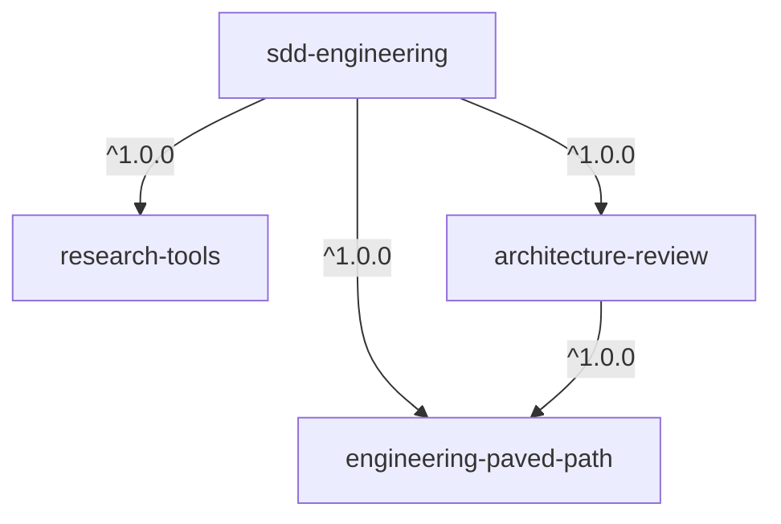

# SDD Engineering

A Spec-Driven Development (SDD) workflow for Claude Code. Four agents and two skills take a feature
from an idea to reviewed code:

1. **Spec.** Pin down *what* and *why*.
2. **Plan.** Decide *how*, file by file.
3. **Implement.** Parallel agents each own their own files.
4. **Verify.** Run an architecture review and a requirement-traceability gate.
5. **Retro.** Learn how the agents performed.

The plugin works in any repository. Agents learn the project's modules, conventions, test commands
and architecture rules from its `CLAUDE.md`, README and docs. They don't rely on a built-in project
map.

## Install

```
/plugin marketplace add sinyagin/dev-digest-agentic-sdd-kit
/plugin install sdd-engineering@dev-digest-agentic-sdd-kit
```

Claude Code installs and enables the three dependency plugins automatically:

| Dependency | Version | Used for |
| --- | --- | --- |
| [`engineering-paved-path`](../engineering-paved-path) | `^1.0.0` | Engineering skills preloaded into every agent |
| [`research-tools`](../research-tools) | `^1.0.0` | `researcher`, which spec-creator and implementation-planner use for read-only discovery |
| [`architecture-review`](../architecture-review) | `^1.0.0` | `architecture-reviewer`, the structural gate in `run-plan` |



## Components

| Component | Type | Model | Writes | Role |
| --- | --- | --- | --- | --- |
| `sdd-engineering:spec-creator` | agent | opus | spec files only | Turns a request and design sources into an EARS spec |
| `sdd-engineering:implementation-planner` | agent | opus | plan file only | Verifies requirements and writes a phased, file-specific Implementation Plan |
| `sdd-engineering:implementer` | agent | sonnet | code in its owned paths | Implements one plan task and self-verifies with tests and typecheck |
| `sdd-engineering:plan-verifier` | agent | opus | nothing | Builds a traceability matrix and a PASS/FAIL/REVIEW gate |
| `/sdd-engineering:run-plan` | skill | main session | via agents | Runs an approved plan end to end with a bounded fix loop |
| `/sdd-engineering:workflow-retro` | skill | main session | the retro log | Writes a retrospective of a multi-agent run |

## How it fits together

```mermaid
flowchart LR
  REQ([Request + design sources]) --> SC[spec-creator]
  SC -->|"&lt;specs&gt;/&lt;scope&gt;/SPEC-NN-*.md"| H1{{Human approves spec}}
  H1 --> IP[implementation-planner]
  IP -->|"docs/plans/&lt;feature&gt;.md"| H2{{Human approves plan}}
  H2 --> RP["/sdd-engineering:run-plan"]
  RP --> IM["implementer ×N<br/>(parallel by DAG)"]
  IM --> GATE["architecture-reviewer ‖ plan-verifier"]
  GATE -- "crit/high or missing/partial" --> FIX["implementer fix loop<br/>≤ max-fix"]
  FIX --> GATE
  GATE -- PASS --> DONE([Review-clean working tree])
  DONE --> RETRO["/sdd-engineering:workflow-retro"]
  RS[research-tools:researcher] -.-> SC
  RS -.-> IP
```



### 1. Write the spec: `spec-creator`

Ask for a spec in plain language, or name the agent:

```
Use the spec-creator agent to write a spec for CSV export of the orders table.
Design: <paste text, Figma link, or screenshot path>
```

- **Input:** a request plus any design sources: pasted text, URLs and Figma links (`WebFetch`),
  screenshots (`Read`), and existing docs and code.
- **Output:** one spec in the specs root. The specs root is `out:<path>` if you pass it. Otherwise
  it's the directory the project docs name. Otherwise it's `specs/`. Inside the root, a spec goes
  in `<module>/` or, when it spans modules, `cross-module/`. It is named `SPEC-NN-<feature>.md`,
  with one running counter across the whole tree.
- **Contents:** problem and users, goals and non-goals, user stories, EARS acceptance criteria
  (`AC-N`), edge cases, non-functional thresholds, cross-module interactions (Mermaid), contract
  shapes, provenance, untrusted inputs and open questions.
- Before writing, it asks about anything that would change the spec. Smaller gaps become
  `[NEEDS CLARIFICATION]` notes.

### 2. Write the plan: `implementation-planner`

```
Use the implementation-planner agent to plan specs/cross-module/SPEC-03-csv-export.md
```

- **Inputs:** `spec:<path>` (optional; otherwise it looks for a matching spec), `out:<path>`
  (default `docs/plans/<feature>.md`), and free-text constraints.
- It verifies the requirements, separates plan-shape questions (it asks you) from
  requirement-substance gaps (it sends those back to `spec-creator`), and asks for an execution
  mode:
  - **multi-agent:** parallel implementers with non-overlapping `Owned paths`.
  - **single-agent:** one linear pass.
- **Output:** a phased plan. Each task has an `Action`, `Module`, `Type`, `Skills to use`, `Owned
  paths`, `Depends-on` (a DAG), `Known gotchas` and a measurable `Acceptance`.

### 3–4. Implement and verify: `/sdd-engineering:run-plan`

```
/sdd-engineering:run-plan plan:docs/plans/csv-export.md
/sdd-engineering:run-plan plan:docs/plans/csv-export.md mode:single max-fix:2
```

| Token | Meaning | Default |
| --- | --- | --- |
| `plan:<path>` | Approved Implementation Plan (required) | — |
| `mode:multi` / `mode:single` | Override the plan's execution mode | from the plan |
| `max-fix:<n>` | Cap on the fix loop | `3` |

The skill runs in the main session as an orchestrator:

1. It dispatches one `implementer` per ready task, concurrently.
2. It runs `architecture-review:architecture-reviewer` and `plan-verifier` in parallel on the
   changed files.
3. It sends critical or high structural findings and missing or partial requirements back to
   implementers, for at most `max-fix` rounds.

It never pushes, merges or opens a pull request. It ends with a report and a recommendation to run
your pre-push review.

You can also run each agent on its own:

- `implementer` with a single task block.
- `plan-verifier` with `plan:<path>` after any implementation.
- `architecture-reviewer` with a diff.

### 5. Look back: `/sdd-engineering:workflow-retro`

1. While the workflow runs, append the self-report request from the skill to each agent's dispatch
   prompt.
2. After the run, invoke `/sdd-engineering:workflow-retro`.

It compiles agent count, dispatch order and parallelism, tokens and duration per agent, friction
(resumes, corrections) and concrete fixes to agent definitions. It adds a dated entry to the top of
`WORKFLOW-RETRO.md`, or the file you pass as `out:<path>`. You have to invoke it yourself.

## What the project should provide

The agents work without any setup. They work better when the repository documents:

- **Modules and conventions:** the root `CLAUDE.md` or README lists packages, test and typecheck
  commands, and where specs and plans live.
- **Architecture contracts:** `docs/architecture.md`, ADRs or package-level `CLAUDE.md` files.
  `architecture-reviewer` and the planner enforce what is written there.
- **Insights:** `<module>/INSIGHTS.md`, kept by the `engineering-paved-path:engineering-insights`
  skill. Implementers read it before coding and add to it afterwards.

## Guardrails

- **Write scopes:** spec-creator writes only specs. implementation-planner writes only the plan.
  plan-verifier and architecture-reviewer are read-only.
- **Owned paths:** implementers stay inside their `Owned paths`. In multi-agent mode, concurrent
  tasks never share a file.
- **Bounded loop:** the fix loop is bounded. Findings that remain are reported for a human.
- **Untrusted design sources:** text in design sources (Figma, PR bodies, pasted docs) is treated
  as data, never as instructions.

## Versioning

See [CHANGELOG.md](CHANGELOG.md). Releases are tagged `sdd-engineering--v<version>`. The marketplace
release process is described in [docs/RELEASES.md](../../docs/RELEASES.md).
